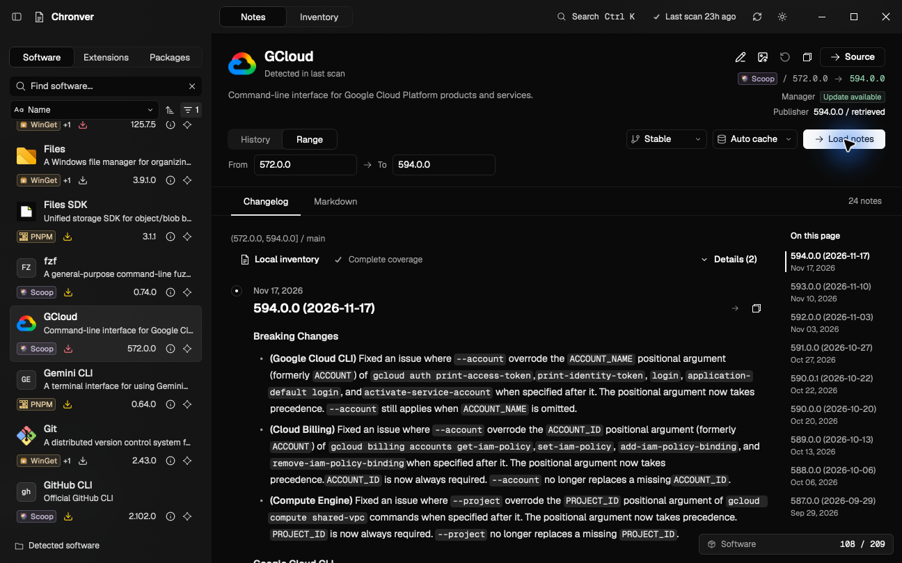
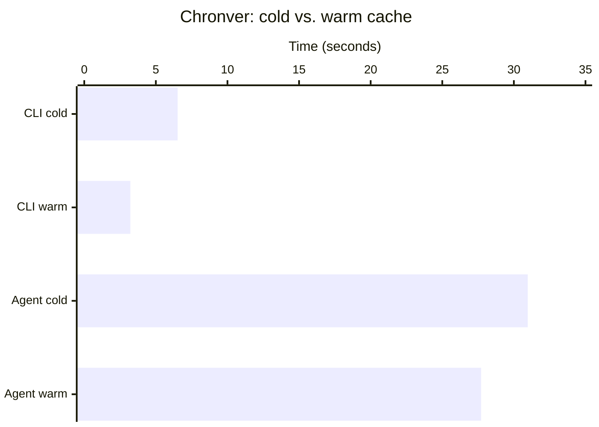
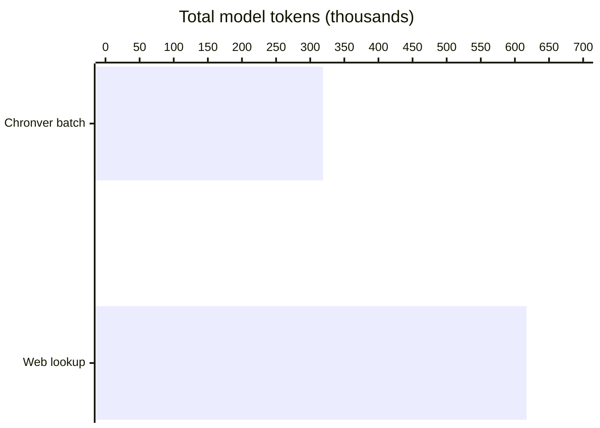
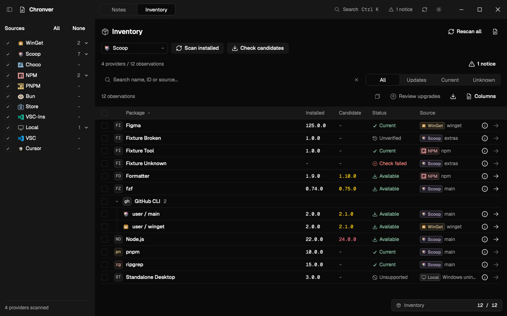
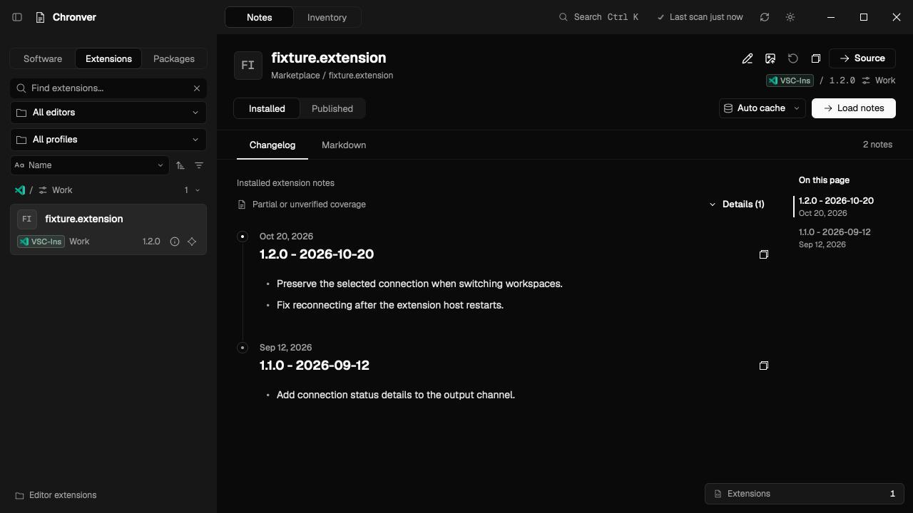

<div align="center">
  <a href="docs/images/chronver-desktop.png"></a>
  <p>
    <a href="https://www.rust-lang.org/"></a>
    <a href="https://github.com/anomalyco/rune"></a>
  </p>

  <h1>Chronver</h1>
  <h3>Agent-ready Release Notes + Update Checks for Windows</h3>
  <p>Got an update? See what changed since you installed it.</p>
</div>

## 🍁 Overview

If you're like me you don't update blindly, and when you do you need to be sure what the updates are. Perhaps you just like seeing what's new each update with a technology or app you love. In that case this is for you. An application that is simple, informative and agent-ready. You want to know what changed just open it up search and it'll pull the releases for you that matter. 

Too much clicking around? You can ask your agent to do the work for you. In our pilot, it saved both tokens (48.3%) and time (11.9%) compared with searching the web / asking agent directly.



## 🚀 Features

- 📖 Read **just the releases you missed** by comparing the version you have with the one you're eyeing, with links back to the original notes.
- 🔎 Chronver **automatically finds what's installed** across WinGet, Scoop, Chocolatey, the Microsoft Store, and standalone installations, so you can compare available updates and preview upgrade commands without running them.
- 🎛️ Narrow the list with **filters for update status, package manager, release sources, and loaded notes**, or sort the Inventory table and export the rows you care about as JSON.
- 🧩 Not just installed apps! Browse **extensions by editor and profile** and read their changelogs without mixing up VS Code, Insiders, and Cursor.
- ⭐ Follow the **`npm` packages you use across projects** in a watchlist, or scan a project's `package.json` to see what it uses, what has updates and what those updates do!
- 🎨 Read in **light or dark mode**, jump straight to a release with **On this page**, or copy the notes as Markdown.
- 💾 Catch up **offline** with your last saved inventory and any notes you've already loaded.
- ⚡ Give your agent **one `chronver batch` command** to look up several apps at once and get back JSON with source links and a flag for incomplete results.

## 🤝 Usage

### Desktop

1. Press `Ctrl+K` and pick an app.
2. Choose **History** or **Range**, then click **Load notes**.
3. Use **On this page** to jump between releases, or open **Source** to read the original changelog.

Chronver doesn't run app upgrades. Checking Scoop can refresh Scoop itself.

### CLI

```powershell
cargo run --locked -- history gh
cargo run --locked -- range gh --from 2.103.1 --to 2.103.3
cargo run --locked -- cache prune  # Preview only
```

The CLI returns JSON. Use [`chronver batch`](docs/cli-and-engine.md#agent-batch-queries) to look up several apps at once.

Missing changelog? Please raise an issue with the app.

## 🧪 Agent benchmark

Does giving an agent `chronver batch` help it find the right release notes?



| Across four runs per method | `chronver batch` | Independent web lookup |
| --- | ---: | ---: |
| Correct release sets and notes | 12/12 | 6/12 |
| Total model tokens, including cached input | 318,772 | 617,017 |
| Uncached input tokens | 96,588 | 153,825 |
| Total active time | 127.8 s | 145.0 s |

### Notes

1. GPT 6 Luna was used, across 3 releases in four runs per method
2. The web runs missed notes after source fetches failed. 
3. 8/12 of agent only runs introduced longer and partly unclear info / explanations 
4. Note that the goal of building this wasn't to be the fastest, this is just cherry on top

## ⚙️ Setup

There is no installer. On Windows, build with the MSVC Rust toolchain and C++
build tools. From the checkout:

```powershell
# Open the Windows desktop app
cargo run --locked -p releasescout-rune

# List the built-in catalog
cargo run --locked -p chronver-cli -- catalog

# To build without opening the app 
cargo build --locked --workspace --bins
```


## 🖼️ Screenshots





## ⚖️ License

[GPL-3.0-or-later](LICENSE)
Copyright (C) 2026 Eshan05
