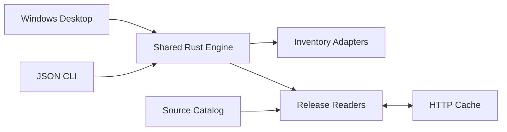

# CLI and Engine Reference

See the [project README](../README.md) for desktop usage and setup.

## Run

From the workspace root, with Cargo installed:

```powershell
cargo run --locked -p chronver-cli -- catalog
```

The CLI is selected by a plain `cargo run` from the workspace root. To build only
that executable, run `cargo build --locked -p chronver-cli`.

### CLI Examples

```powershell
cargo run --locked -- range gh --from 2.103.1 --to 2.103.3
cargo run --locked -- range atlas-cli --from 1.57.0 --to 1.59.4
cargo run --locked -- updates notion --since 2026-10-01 --until 2026-11-10
cargo run --locked -- inspect supabase --component hosted
cargo run --locked -- range supabase --component cli --from 2.40.0 --to 2.41.0
cargo run --locked -- inspect podman --component desktop
cargo run --locked -- inspect terminal-preview
cargo run --locked -- history agent-browser
cargo run --locked -- history agent-browser --cursor previous-page.json
cargo run --locked -- scan --manager pnpm --show-plan
cargo run --locked -- scan --manager winget
cargo run --locked -- scan --manager scoop --check-updates
```

Version examples are query inputs, not claims about the installed or latest version.

### Agent Batch Queries

`chronver batch --input queries.json --jobs 3` runs up to eight read-only
queries concurrently, preserving input order and isolating errors per query.
`--input -` reads stdin. The request is capped at 1 MiB and 32 unique keys:

```json
{"schema_version":1,"queries":[
  {"key":"github-cli","package":"gh","query":{"kind":"range","from":"2.103.1","to":"2.103.3","channel":"stable"}},
  {"key":"notion","package":"notion","query":{"kind":"updates","since":"2026-10-01","until":"2026-11-10"}},
  {"key":"browser","package":"agent-browser","query":{"kind":"history"}}
]}
```

An optional `component` selects a product stream. History queries accept the
existing `cursor` object. Standard `--cache-dir`, `--offline`, `--refresh`,
`--include-inactive`, and `--output` flags still apply. Batch stdout is compact
JSON, not progress text. After argument parsing, exit 1 means invalid batch input/configuration; exit 2 means
one or more query/source failures, with successful results still returned.
Partial source coverage and bounded excerpts are explicit JSON states, not errors.

Defaults return at most 20 notes per result, 16,384 UTF-8 bytes per note body,
and 65,536 body bytes across the batch. These limits exclude JSON metadata,
warnings and provenance. Change them with `--note-limit`, `--body-bytes` and
`--body-budget-bytes`. Existing single-query commands retain their output format.

Each result retains `status`, warnings and evidence. `source_complete` describes
retrieval, `output_complete` describes whether all retrieved text was returned,
and `complete` requires both. Each note has `body_truncated` and a `body_range`
with actual UTF-8 offsets and `next_offset_bytes`. Continue an excerpt with
`--body-offset-bytes`; use `--note-offset`/`--note-limit 1` to select the note.
For note pagination follow `output.next_note_offset`. Finish those transport
pages before following a history result's separate `next` source cursor.
If the shared body budget is exhausted, retry only the affected query/note with
adequate budget. Never interpret omitted text as no upstream changes.

Duplicate-version warnings for a version range concern only its selected channel
and inclusive boundary window `[from, to]`; the lower boundary is still checked
even though emitted notes use `(from, to]`. Inspect/history remain conservative
about ambiguities anywhere in their retrieved snapshot.

### Single Queries

`inspect` is a diagnostic view of retrieved history, including all channels; it
does not determine which software is installed or what should be upgraded.
`history` returns at most 20 notes and a `next` cursor. Save its JSON with the
global `--output previous-page.json` option to request the next page explicitly.
GitHub History fetches one 20-release API page, not the entire release list.
Document/feed sources must download/cache their whole document before returning
a 20-note window. `inspect` and interval queries keep their existing coverage budgets.

`scan` is opt-in and read-only, with one manager per invocation: `winget`, `scoop`,
`chocolatey`, `npm`, `pnpm`, `bun`, `store`, or `vscode-insiders`. `--show-plan` prints commands without
executing them. `--check-updates` also asks the manager for candidate versions;
it may contact configured registries, but never installs packages or refreshes
Scoop buckets. Store/Appx availability remains unknown. Note-cache flags do not
apply to inventory scans. See [inventory adapters](inventory-adapters.md)
for scope, identity rules and current limitations.

Global options: `--catalog path.json`, `--cache-dir path`, `--offline`,
`--refresh`, `--output report.json`, `--include-inactive`. Version ranges accept
`--channel stable|preview|all`; absent an override, the stream's configured
channel applies (Preview for Windows Terminal Preview).

Exit codes: 0 for a report (including partial/sparse results), 1 for invalid
configuration/query or local I/O failure, 2 when every source failed. Always read
the JSON `status`, `complete`, `warnings`, and `attempts`, not just the exit code.

## Architecture



The [Rune desktop app](../desktop/) and [CLI](../cli/) share the same [Rust engine](../engine/).

## Shared Adapters

- GitHub published releases: bounded pagination, explicit tag prefix or named
  regex capture, draft exclusion, prerelease metadata, source URLs and bodies.
- Markdown/HTML/plain changelogs: whole heading or paragraph boundaries with
  named `version`/`date` captures. HTML uses a CSS content root and converts to
  Markdown after removing scripts/navigation and empty heading-permalink icons.
- RSS/Atom feeds: publication dates and authored content, using `feed-rs`.
- Versioned documentation indexes: same-origin CSS links, bounded detail fetches,
  range filtering, and a shared content selector. Fixture-tested; no bundled
  production profile uses this adapter yet.

Per-product configuration lives in [the engine catalog](../engine/data/catalog.json), not bespoke scraper
functions. New website layouts generally need a profile, not new engine code.
An unrecognized layout is an explicit failure, never an empty success.

The bundled catalog contains reusable product identities, aliases, source
profiles, and references. A catalog entry is not an installed application and
may have no runnable profile. Personal tracking choices and source overrides
are optional local settings; see [catalog configuration](catalog.md).
The [coverage ledger](source-coverage.md) is a historical audit, not a
current source-health check.

Multi-component products stay separate: Podman engine/CLI vs Desktop, Supabase
CLI vs hosted/ecosystem updates. Node/npm currently has an npm-only profile;
Node's runtime profile is still pending. Gel remains unconfigured rather than
mistaking CLI notes for database changes. VS Code Insiders, ChatGPT desktop and
Codex require channel/category-aware profiles; stable or unfiltered product
notes are not substituted. Excluded/deferred/covered-elsewhere rows are retained
but require an explicit opt-in and a configured profile before fetching.

## Correctness Contract

- Versions select **(installed, target]**, sorted by version precedence, not
  publication order. Both boundary versions must appear in retrieved history
  before `complete` can be true. GitHub pagination never stops at an old version.
- SemVer uses the `semver` crate, ignoring build metadata for precedence. Numeric
  streams explicitly support 2-4 integer components, zero padding and optional
  SemVer-style prerelease suffixes. Unsupported versions are reported, not
  compared lexically or coerced into floats.
- Dated product feeds select **(since, until]**, using UTC publication dates.
  The retrieved history must reach `since`; `until` cannot be in the future.
  They are not evidence of a desktop binary's version or availability.
- Drafts, channel mismatches and configured unrelated monorepo tags are excluded.
  Ambiguous normalized versions and unsupported tags mark results partial.
- Empty, compare-link-only and recognized download/checksum-only releases are
  retained with `authored_notes: false`. The content-quality check is conservative
  and heuristic; it is not a summary or a guarantee of substantive detail.
- Pagination caps, missing boundaries, sparse selected notes, later-page failures
  and offline snapshots prevent a completeness claim. Earlier notes survive a
  later GitHub page failure. Ordered fallbacks choose one best source result;
  histories from incompatible sources are not merged silently.
- `complete` means coverage of authored notes within the retrieved source/window,
  **not** proof every upstream build has notes. Curated profile correctness and
  upstream history omissions remain limitations. No-matching-notes is never a
  declaration that no software update exists.

Reports contain source attempts, timestamps/cache provenance, raw authored bodies,
and warnings. Markdown and source URLs remain **untrusted content**. A UI must
disable/sanitize raw HTML and unsafe links, and resolve relative Markdown links
against each note's `url`. The HTML adapter resolves its relative links already.

Post-review guarantees: same-level non-release subsections stay attached to their
release; ambiguous enclosing headings fail explicitly instead of truncating notes.
Both version endpoints must belong to the selected channel for completeness.
An empty fallback never replaces nonempty partial notes. RSS/Atom edit timestamps
are not publication dates: undated items remain inspectable and coverage partial.
Malformed GitHub dates and pagination retain fetched notes/evidence, stop unsafe
traversal, and emit warnings. Package/stream caveats also survive source failures.
T3 Code's profile matches versioned nightly tags only, excluding stable and
maintainer-preview builds.

## Network And Cache

`reqwest` uses HTTPS, TLS verification, 10-second connect/30-second request
timeouts, an 8 MiB body cap and at most three same-origin redirects. Configure a
canonical URL for a cross-origin redirect. GitHub pagination rebuilds the known
repository endpoint from a validated next-page number; it never follows a link
to a different repository or host.

The on-disk HTTP cache is compressed and bounded to 32 MiB per directory, with a
15-minute default TTL, atomic writes, and ETag/Last-Modified revalidation with
`--refresh`. `--offline` is cache-only, preserves timestamps, and marks freshness
unknown. Run `chronver cache prune` to preview cleanup or add `--apply` to remove
old raw responses without touching saved notes or inventory. See [caching](caching.md).

Optional `GITHUB_TOKEN` is read from the environment and sent only to the exact
`https://api.github.com` origin. The cache key is scoped by a hash of URL/token;
the token and response cookies are never stored. No CLI credential borrowing.
There is no retry loop for rate limits; reports give the HTTP status explicitly.

Library fetching is blocking. Run it on a worker thread when integrating Rune or
Tauri; never call it on the UI thread or directly inside an async runtime task.

## Verification

```powershell
cargo test --locked --workspace
cargo clippy --locked --workspace --all-targets -- -D warnings
cargo build --locked --workspace --bins
```

The default tests use local fixtures and include a synthetic GitHub API response,
engine correctness regressions, paged History, inventory fixtures and Windows
PowerShell syntax checks that never execute manager commands. See
[review disposition](engine-review.md).
The opt-in `cargo run --locked -p releasescout-engine --example live_smoke`
checks 24 public sources and then replays actual
adjacent version/date ranges. It does not execute installed package binaries.
Reports/progress are saved under ignored `artifacts/live/`; any missing authored
range makes the smoke run fail. An optional list of IDs restricts that run.

On 2026-11-10 all 24 yielded authored-note ranges: 19 complete and 5 explicitly
partial (ambiguous historical tags or bounded GitHub history). Atlas also passed
the owner's known 1.57.0 -> 1.59.4 interval. These are captured observations,
not permanent source-health claims. The source ledger records which profiles
were actually exercised. Other configured sources still need live validation.

For profile authoring, `cargo run --locked -p releasescout-engine --example profile -- HTTPS_URL CSS_ROOT`
prints the shared HTML-to-Markdown representation. Use strict whole-block
captures and test against layout changes; don't loosen a regex to match arbitrary
numbers in prose. The runtime catalog is self-contained; no local research
directory is required.

## Remaining Scope

Finish and validate unconfigured source/channel profiles. The Rune trial now
accepts explicit ranges, paged history and automatic startup inventory off the UI
thread. Exact source bindings live in `engine/data/inventory-bindings.json`; unmatched
records remain visible without guessed notes. The default Apps & Tools view hides
evidence-backed system/support components and groups verified product identities
without discarding individual observations. Timestamped inventory is persisted
locally. The desktop does not bundle a fallback list of installed software.
See [inventory identity and offline
reconciliation](inventory-identity.md) for matching boundaries and audit commands.
The [default classification policy](inventory-classification.md) uses local
provider/OS metadata to hide system/support payloads, with a reversible toggle.
Insiders extensions are enumerated across registered local profiles and counted
separately from apps/tools.
Selected software without a reviewed extraction profile now uses a bounded,
cached [source-discovery cascade](source-discovery.md): reviewed references,
installed package metadata, exact WinGet manifests, declared repositories,
changelogs and website-declared feeds. Unsuccessful discovery is retryable;
automatically discovered notes never imply complete coverage or compatible updates.
Project dependencies have a separate [Packages inventory](project-packages.md),
starting with read-only `package.json` discovery and shared release-source readers.
Broader binding coverage, Cargo/Python/Go dependency discovery, full Store
update checks, icon resolution, scheduled checks, update execution,
product/category filtering and optional summaries remain outside this milestone.
